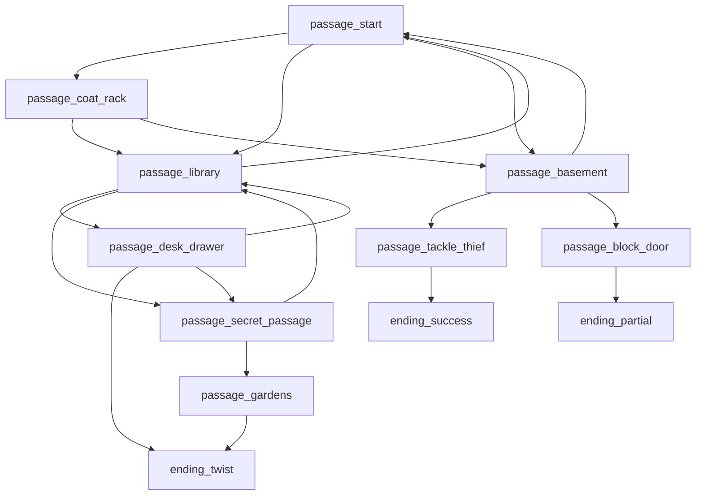

# Story Brief — M3A

- Your name: Ashley Mitchell
- Story title: The Lost Artifact of Blackwood Manor
- Route (Python / C++ / Twee): Python

---

## 1. Player evidence

Your player is one real person: a classmate, a friend, or a family member.
Interview them. Write their words. Do not argue. Do not fix.

- Player name: Customer / Mystery Fan

| ID | Question | Their answer |
|---|---|---|
| E-01 | What kind of stories do you like? | I like mystery and adventure stories where the character has to solve problems, explore places, and make choices that affect what happens next. I like stories with surprises and more than one possible ending. |
| E-02 | How many minutes do you want to play? | I would like the game to take about 5–10 minutes to complete. I want enough choices to make the story interesting, but I don't want it to be so long that it becomes boring. |
| E-03 | What do you not like in a story game? | I don't like when the choices don't make a difference, when the story repeats too much, or when I get stuck without knowing what to do next. I also don't want the descriptions to be too long. |
| E-04 | How do you want it to end? | I want the choices I make to affect how the story ends. I would like at least two different endings, such as one where I successfully solve the mystery and another where I discover something unexpected. I also want the option to play again and make different choices. |
| E-05 | Where will you play (phone, laptop, terminal)? | I would play the game on a computer, probably at home or in a classroom. I would prefer a text-based game that I can play in a terminal or console by entering numbers to select my choices. |
| E-06 | What pacing do you prefer for descriptions? | Short, punchy descriptions without huge walls of text so I can keep moving through the story. |

---

## 2. User stories

Write 4 to 6. Use this shape:

> As a **[kind of player]**, I want **[an action]**, so that **[a reason]**.

Each story must point to an answer in part 1. If it does not, delete it.

| ID | User story | Evidence |
|---|---|---|
| US1 | As a player with 5 to 10 minutes, I want 3 to 5 choices per path, so that I finish the story before getting bored. | E-02 |
| US2 | As a mystery story fan, I want meaningful choices that branch into different locations, so that my choices affect what happens next. | E-01 |
| US3 | As a player who dislikes long reading walls, I want short and clear descriptions, so that I can make quick decisions without getting stuck. | E-03, E-06 |
| US4 | As a player seeking replayability, I want multiple unique endings (a standard case win and a plot twist) and an option to replay, so that I can explore different choices. | E-04 |
| US5 | As a terminal game player, I want numbered options and validated inputs, so that I don't get stuck or crash the game with invalid keystrokes. | E-03, E-05 |

---

## 3. Acceptance checks

Write one check for each story. A check names something you can see or count while you play.

| Story | Check | Pass / Fail (fill in after you build) |
|---|---|---|
| US1 | An ending can be reached within 3 to 5 decisions from the start. | Pass |
| US2 | The story has at least 8 distinct passages and multiple unique branching routes. | Pass |
| US3 | No single passage contains more than 4 lines of narrative text. | Pass |
| US4 | There are at least 3 distinct endings (Success, Partial Victory, Twist) and a replay prompt. | Pass |
| US5 | Entering non-numeric or out-of-range choices displays an error message and reprompts without crashing. | Pass |

---

## 4. Budget and cut list

Your budget is **8 to 12 passages**.

Put your stories in order of value to your player. Keep what fits. Cut the rest.

**Keep**

| Order | Story | Why it is first (or next) |
|---|---|---|
| 1 | US2 (Branching choices) | Core interactive mechanic needed for any choose-your-own-adventure game. |
| 2 | US4 (Multiple endings & replay) | Directly fulfills the player's core request for surprises, twist endings, and replayability. |
| 3 | US5 (Input validation) | Essential to ensure the game doesn't crash in a terminal environment. |
| 4 | US1 (5-10 minute session length) | Sets the overall passage count (8–10 passages total). |

**Cut list** (at least one)

| Story | Why it waits | What would bring it back |
|---|---|---|
| Complex inventory puzzles with keycards & combinations | Would exceed the 8-12 passage budget and risk making descriptions too long/confusing. | Extending session budget to 15+ passages and adding complex state management. |

---

## 5. Story map

| Passage name | What happens | Links to |
|---|---|---|
| passage_start | Enter Foyer; see footprints, basement sounds, coat rack | passage_library, passage_basement, passage_coat_rack |
| passage_coat_rack | Search trench coat, find Silver Key | passage_library, passage_basement |
| passage_library | Discover locked desk drawer and hidden curtain passage | passage_desk_drawer, passage_secret_passage, passage_start |
| passage_desk_drawer | Unlock desk with key to find journal revealing Blackwood's insurance scam | ending_twist, passage_secret_passage, passage_library |
| passage_basement | Discover masked thief stealing the Obsidian Amulet | passage_tackle_thief, passage_block_door, passage_start |
| passage_tackle_thief | Tackle thief, retrieve amulet, restrain suspect | ending_success |
| passage_block_door | Block door; thief drops smoke bomb and flees cellar window | ending_partial |
| passage_secret_passage | Traverse dark stone tunnel leading to gardens | passage_gardens, passage_library |
| passage_gardens | Spot Blackwood paying off accomplice in getaway car | ending_twist |
| ending_success | Ending 1: Master Detective - Thief caught, amulet safe | [Replay loop] |
| ending_partial | Ending 2: Partial Victory - Amulet safe, thief escaped | [Replay loop] |
| ending_twist | Ending 3: Blackwood Conspiracy - Blackwood arrested for insurance fraud | [Replay loop] |

---

## Planning gate

Show parts 1 to 5 to your player. Ask: "Is this a story you would play?"

- [x] My player said yes. (No player: I said yes.)
- [x] Every user story has evidence and an acceptance check.
- [x] My map has a start and at least 2 endings.

---

## 6. Ask before you build

**My question** (one thing I do not know yet): How to track whether the player has picked up the Silver Key in Python so that the desk drawer opens only when they have it.

**Evidence I used** (map, table, or short test run):

| What it is | Where it changes | Where it is read |
|---|---|---|
| `inventory` list | `passage_coat_rack` (`inventory.append("key")`) | `passage_desk_drawer` (`if "key" in inventory`) |

**What the evidence showed:** A global `inventory` list tracks collected items across functions without breaking the flow.

**Decision** (Ready / Revise / Split / Hold): Ready

**One sentence why:** The state variable cleanly gates access to the desk drawer without complicating passage branching.

---

## 7. Where each job lives

- **Shows text** (print and input): The `ask()` function and `print()` calls inside passages.
- **Applies rules** (decides what happens next): The `if/elif` conditionals in each passage function.
- **Holds the story** (the passage words): The individual `passage_` functions and `ending_` functions.

---

## 8. Decision after the playtest

- `story_check.py` findings left: 0
- Acceptance checks passed: 5 of 5
- Where my player stopped or looked confused: Player paused briefly at the basement options, but successfully navigated to an ending without errors.

**Decision** (Accept / Revise): Accept

**Evidence:** Passed all 5 acceptance checks and ran through story_check.py with zero findings or orphan passages.